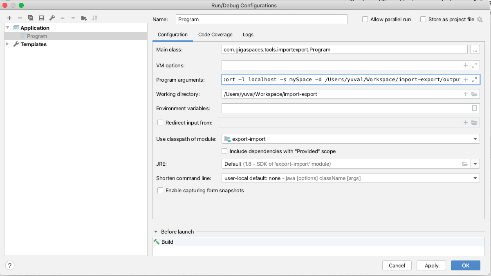

# Introduction

The Export/Import tool is used to facilitate reliable and efficient snapshots of data in GigaSpaces using Java Serialization.

Instructions on how to use the Import/Export tool and how it was implemented can be found on GigaSpaces [Solution Hub](https://docs.gigaspaces.com/latest/solution-hub/export-import-tool.html) wiki.

### Build and Running the Tool
#### Prerequisites
 * Java IDE
 * JDK 17
 * Apache Maven
 
##### Configuration
Check the pom.xml file to ensure `gigaspaces.version` is configured to use the same version of GigaSpaces you have installed.
```
    <properties>
        <gigaspaces.version>17.1.2</gigaspaces.version>
        ...
    </properties>
```

#### Building

mvn clean package

#### Running

###### Option 1 (from the IDE using maven)
1. Deploy the newly built export-import-1.0.SNAPSHOT.jar into your local git repository.
   ``` 
   mvn install:install-file -Dfile=../import-export/target/export-import-1.0-SNAPSHOT.jar -DgroupId=org.gigaspaces -DartifactId=xap-export-import -Dversion=15.5.0 -Dpackaging=jar
   ```
2. Click on "Edit Configurations" and set it with:  
 **Main class**: `com.gigaspaces.tools.importexport.Program`  
 **Program arguments**: `-o export -l $LOOKUPLOCATORS -s {your Space} -d {your output location} --jarless`

 
 
###### Option 2 (from CLI using maven classpath) - currently not working
```
mvn exec:java -Dexec.mainClass=com.gigaspaces.tools.importexport.Program -Dexec.args="-o export -l $LOOKUPLOCATORS -s mySpace -d /var/exporter/output"
```

###### Option 3 (setting the classpath)
 1. Copy the newly built export-import-1.0.SNAPSHOT.jar into the lib directory.  
 2. Run 
    ```
    $JAVA_HOME\bin\java -cp $GS_HOME/lib/required/*:./lib/* com.gigaspaces.tools.importexport.Program -o export -l $LOOKUPLOCATORS -s mySpace -d /var/exporter/output
    ```
